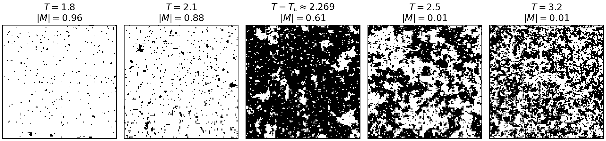

::: {.hero}
::: {.hero-text}
<h1 class="hero-title">Deep Learning in Classical and Quantum Physics</h1>

A course at the Faculty of Physics, Astronomy and Applied Computer Science, Jagiellonian University in Kraków

Neural networks from first principles, applied to classical and quantum physics: the fundamentals of deep learning, capturing correlations, classical deep learning with quantum data, reinforcement learning for quantum tasks, and explainability and uncertainty in deep learning.

<a href="https://chaos.if.uj.edu.pl/marcinplodzien/"><b>Marcin Płodzień</b></a> · Atomic Optics Department, Institute of Theoretical Physics, Jagiellonian University in Kraków

[Start with Lecture 1](lectures/lecture-01.qmd){.btn .btn-primary} [Browse the lectures](#lectures){.btn .btn-outline-primary}
:::

::: {.hero-image}
{fig-alt="Spin configurations of the 2D Ising model below, at and above the critical temperature"}
:::
:::

## The course

The course consists of on-site lectures and hands-on workshops with computer labs in Google Colab; it is assessed by an assignment, a problem solution with a report, and an oral exam: the defence of the report and two questions. Each lecture comes with its slides and with Jupyter notebooks, shown with their stored outputs; each notebook page has an *Open in Colab* button.

## Lectures {#lectures}



## Main reading

- T. Heightman, M. Płodzień, *Deep Learning in Classical and Quantum Physics*, Springer (to appear, 2027), [arXiv:2508.10666](https://arxiv.org/abs/2508.10666)
- A. Dawid, J. Arnold, …, M. Płodzień et al., *Machine Learning in Quantum Sciences*, Cambridge University Press (2025), [arXiv:2204.04198](https://arxiv.org/abs/2204.04198)
