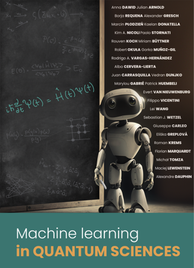
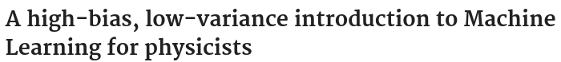
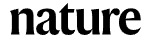
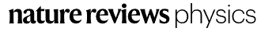
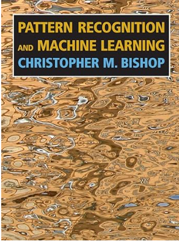
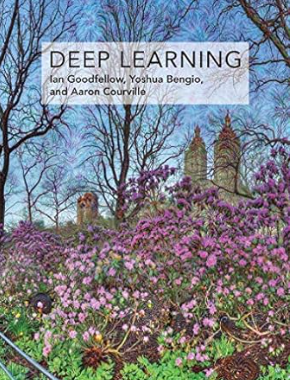
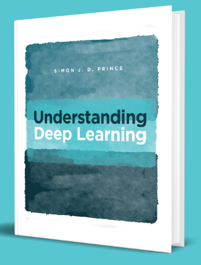
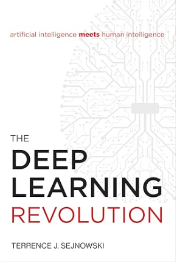
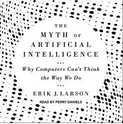

## Lecture notes, ML for physics and science

::: {.res-grid}

::: {.res-card}
::: {.res-thumb}
{fig-alt="Deep Learning in Classical and Quantum Physics"}
:::
::: {.res-body}
::: {.res-title}
Deep Learning in Classical and Quantum Physics
:::
::: {.res-line}
Dedicated lecture notes · T. Heightman, M. Płodzień
:::
::: {.res-link}
[arXiv:2508.10666](https://arxiv.org/abs/2508.10666)
:::
:::
:::

::: {.res-card}
::: {.res-thumb}
{fig-alt="Modern applications of machine learning in quantum sciences"}
:::
::: {.res-body}
::: {.res-title}
Modern applications of machine learning in quantum sciences
:::
::: {.res-line}
Machine learning in quantum sciences · A. Dawid et al.
:::
::: {.res-link}
[arXiv:2204.04198](https://arxiv.org/abs/2204.04198)
:::
:::
:::

::: {.res-card}
::: {.res-thumb}
{fig-alt="A high-bias, low-variance introduction to Machine Learning for physicists"}
:::
::: {.res-body}
::: {.res-title}
A high-bias, low-variance introduction to Machine Learning for physicists
:::
::: {.res-line}
Phys. Rep. 810, 1–124 · P. Mehta et al.
:::
::: {.res-link}
[doi:10.1016/j.physrep.2019.03.001](https://doi.org/10.1016/j.physrep.2019.03.001)
:::
:::
:::

::: {.res-card}
::: {.res-thumb}
{fig-alt="Introduction to Machine Learning for the Sciences"}
:::
::: {.res-body}
::: {.res-title}
Introduction to Machine Learning for the Sciences
:::
::: {.res-line}
T. Neupert, M. H. Fischer, E. Greplova, K. Choo, M. M. Denner
:::
::: {.res-link}
[arXiv:2102.04883](https://arxiv.org/abs/2102.04883)
:::
:::
:::

::: {.res-card}
::: {.res-thumb}
{fig-alt="Scientific discovery in the age of artificial intelligence"}
:::
::: {.res-body}
::: {.res-title}
Scientific discovery in the age of artificial intelligence
:::
::: {.res-line}
Nature 620, 47–60 · H. Wang et al.
:::
:::
:::

::: {.res-card}
::: {.res-thumb}
{fig-alt="On scientific understanding with artificial intelligence"}
:::
::: {.res-body}
::: {.res-title}
On scientific understanding with artificial intelligence
:::
::: {.res-line}
Nature Reviews Physics 4, 761–769 · M. Krenn et al.
:::
:::
:::

:::

## Mathematics and the broader context of AI

::: {.res-grid}

::: {.res-card}
::: {.res-thumb}
{fig-alt="Pattern Recognition and Machine Learning"}
:::
::: {.res-body}
::: {.res-title}
Pattern Recognition and Machine Learning
:::
::: {.res-line}
C. M. Bishop
:::
:::
:::

::: {.res-card}
::: {.res-thumb}
{fig-alt="Deep Learning"}
:::
::: {.res-body}
::: {.res-title}
Deep Learning
:::
::: {.res-line}
I. Goodfellow, Y. Bengio, A. Courville
:::
:::
:::

::: {.res-card}
::: {.res-thumb}
{fig-alt="Understanding Deep Learning"}
:::
::: {.res-body}
::: {.res-title}
Understanding Deep Learning
:::
::: {.res-line}
S. J. D. Prince
:::
:::
:::

::: {.res-card}
::: {.res-thumb}
{fig-alt="The Deep Learning Revolution"}
:::
::: {.res-body}
::: {.res-title}
The Deep Learning Revolution
:::
::: {.res-line}
T. J. Sejnowski
:::
:::
:::

::: {.res-card}
::: {.res-thumb}
{fig-alt="The Myth of Artificial Intelligence: Why Computers Can't Think the Way We Do"}
:::
::: {.res-body}
::: {.res-title}
The Myth of Artificial Intelligence: Why Computers Can't Think the Way We Do
:::
::: {.res-line}
E. J. Larson
:::
:::
:::

:::
